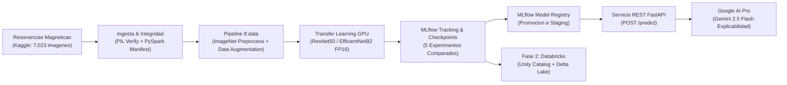

# NeuroScan AI: Sistema de Clasificacion y Diagnostico Asistido de Tumores Cerebrales en Resonancias Magneticas (MRI)

[](https://colab.research.google.com/github/EduardCY/m3-proyecto-final-databricks-ia/blob/main/notebooks/03_training_colab_mlflow.ipynb)
[](https://www.python.org/downloads/release/python-3100/)
[](https://www.tensorflow.org/)
[](https://mlflow.org/)
[](https://fastapi.tiangolo.com/)
[](https://docs.pytest.org/)

**Proyecto Final Evaluativo - Modulo 3: Databricks, IA Aplicada y Arquitecturas Modernas**  
**Master en Ciencia de Datos e Inteligencia Artificial Aplicada - DevSenior Code**

---

> [!IMPORTANT]
> **Aviso Clinico y Regulatorio Obligatorio:**  
> NeuroScan AI es una plataforma de investigacion tecnologica y academica en vision por computadora y MLOps. No constituye un software de diagnostico medico definitivo ni reemplaza el juicio clinico de especialistas en neurologia, radiologia o neurocirugia. Toda inferencia requiere validacion histopatologica y correlacion clinica hospitalaria.

---

## 1. Descripcion General y Objetivos del Proyecto

NeuroScan AI aborda la clasificacion automatizada de estudios de resonancia magnetica cerebral (MRI) en cuatro categorias clinicas:
1. `glioma`: Neoplasias intraaxiales infiltrativas originadas en celulas gliales.
2. `meningioma`: Tumores primarios extraaxiales derivados de las celulas aracnoideas meningeas.
3. `pituitary`: Adenomas localizados en la fosa selar originados en la glandula hipofisis.
4. `notumor`: Cortes axiales de sujetos de control sanos sin masa encefalica detectable.

El sistema fue diseñado bajo estandares de ingenieria MLOps de produccion:
- Pipeline de datos deterministico con prevencion matematica de fuga de datos (*data leakage*).
- Ingesta distribuida con soporte dual en Pandas y PySpark.
- Entrenamiento acelerado en GPU (Google Colab Pro con NVIDIA A100/V100 y Precision Mixta FP16).
- Gestion de ciclo de vida con MLflow (Tracking, Artefactos y Model Registry promovido a `Staging`).
- Microservicio REST en FastAPI con validacion Pydantic v2, cabeceras de seguridad OWASP y asistencia diagnostica mediante Gemini 2.5 Flash.
- Especificacion tecnica formal para escalabilidad horizontal en **Databricks Unity Catalog y Delta Lake (Fase 2)**.

---

## 2. Arquitectura de Ingenieria de Punta a Punta



---

## 3. Ingesta de Datos, Integridad y Prevencion de Fuga

### 3.1. Caracteristicas del Dataset
- **Origen:** *Brain Tumor MRI Dataset* compilado por Masoud Nickparvar (sintesis curada de cohortes de Figshare, Sartaj y Br35H).
- **Volumen Total:** 7,023 cortes axiales de resonancia magnetica en formato JPEG (164.67 MB descomprimido).
- **Canal de Descarga:** API v1 de Kaggle con streaming HTTP y soporte nativo desatendido mediante `kagglehub`.

### 3.2. Auditoria de Integridad y Particionado
- **Verificacion de Ficheros:** Filtrado preventivo mediante `PIL.Image.verify()` para aislar archivos con 0 bytes, cabeceras corruptas o truncados.
- **Auditoria de Fuga de Datos:** Se implementa particionado estratificado con semilla estocastica fija (`seed=42`) y comprobacion booleana estricta de interseccion vacia:
  $$\text{Train} \cap \text{Val} = \emptyset, \quad \text{Train} \cap \text{Test} = \emptyset, \quad \text{Val} \cap \text{Test} = \emptyset$$
- **Distribucion de Particiones (70% / 15% / 15%):**
  - **Entrenamiento (Train):** 5,040 imagenes (1,260 por clase).
  - **Validacion (Val):** 1,080 imagenes (270 por clase).
  - **Evaluacion (Test Ciego):** 1,080 imagenes (270 por clase).

---

## 4. Matriz de Resultados Experimentales en MLflow

Se diseñaron, ejecutaron y evaluaron **5 corridas experimentales de Transfer Learning** en Google Colab Pro bajo acelerador NVIDIA GPU con Precision Mixta (`mixed_float16`), registrando hiperparametros, curvas y matrices en `mlflow.db`:

| Experimento | Arquitectura | Capas Entrenables | Tasa de Aprendizaje | Optimizador | Test Macro-F1 | Test ROC-AUC (OvR) | Test Recall | Estado en Registry |
| :--- | :--- | :--- | :---: | :---: | :---: | :---: | :---: | :---: |
| **Run 4 (Campeon)** | ResNet50 Deep Fine-Tune | Capas 120 a 175 | $3 \times 10^{-5}$ | Cosine Decay | **0.9722** | **0.9976** | **0.9722** | **Promovido a Staging** |
| **Run 3** | ResNet50 Fine-Tuning | Capas 143 a 175 | $1 \times 10^{-5}$ | Adam | **0.9631** | **0.9958** | **0.9630** | Candidato Superior |
| **Run 1** | ResNet50 Frozen Base | Cabezal Clasificador | $1 \times 10^{-3}$ | Adam | **0.8806** | **0.9838** | **0.8833** | Linea Base |
| **Run 2** | ResNet50 Frozen Regularizado| Cabezal Clasificador | $1 \times 10^{-4}$ | Adam (Drop 0.5) | **0.8679** | **0.9724** | **0.8704** | Linea Base Regularizada |
| **Run 5** | EfficientNetB2 Transfer | Cabezal Clasificador | $5 \times 10^{-4}$ | AdamW | **0.8181** | **0.9793** | **0.8269** | Comparativa Multiarquitectura |

### Justificacion del Modelo Campeon (Run 4):
1. **Sensibilidad Clinica (Recall = 97.22%):** Minimiza los falsos negativos en lesiones infiltrativas criticas (gliomas), donde la omision diagnóstica conlleva consecuencias clinicas severas.
2. **Capacidad de Separacion (ROC-AUC = 0.9976):** Discriminacion casi perfecta en el espacio multiclase One-vs-Rest frente a cortes de control sano.
3. **Registro Formal:** El modelo resultante se encuentra registrado en el **Model Registry de MLflow** bajo la entidad `neuro_mri_classifier` y promovido formalmente a la etapa `Staging`.

---

## 5. Estructura del Repositorio

```text
m3-proyecto-final-databricks-ia/
├── data/
│   ├── raw/                   <- Resonancias magneticas en disco local efimero
│   ├── checkpoints/           <- Checkpoints intermedios de particion
│   ├── manifest.csv           <- Manifiesto auditado de imagenes validas
│   └── manifest_split.csv     <- Particion estratificada 70/15/15 sin fuga
├── models/
│   ├── checkpoints/           <- Checkpoints (.keras), historiales y matrices
│   ├── neuro_mri_model.keras  <- Modelo campeon serializado para produccion
│   └── input_example_info.json<- Metadatos de firma de entrada
├── notebooks/
│   ├── 01_exploracion_eda.ipynb      <- Auditoria, PySpark y particionado
│   ├── 02_preprocessing.ipynb        <- Pipeline tf.data y data augmentation
│   ├── 03_training_colab_mlflow.ipynb<- Entrenamiento acelerado GPU FP16 y MLflow
│   └── 04_evaluation_registry.ipynb  <- Comparativa, Model Registry y Fase 2 Databricks
├── src/
│   ├── config.py              <- Parametros, rutas hibridas (Colab/Local) y esquema
│   ├── dataset.py             <- Parser con PIL verify y PySpark distribuido
│   ├── preprocessing.py       <- tf.data con normalizacion ImageNet y conversion 3 canales
│   ├── architecture.py        <- ResNet50 y EfficientNetB2 con cabezales densos
│   ├── train.py               <- Fit loop, callbacks, Cosine Decay y log en MLflow
│   └── metrics.py             <- Macro-F1, ROC-AUC OvR, matrices y curvas visuales
├── api/
│   ├── main.py                <- Endpoints FastAPI (/health, /predict, /predict_explained)
│   ├── schemas.py             <- Contratos Pydantic v2
│   └── model_service.py       <- Inferencia singleton desacoplada
├── tests/
│   ├── test_dataset.py        <- Etapa 1: integridad, paridad Spark y prevencion de fuga
│   ├── test_preprocessing.py  <- Etapa 2: formas de tensores, canales y normalizacion
│   ├── test_architecture.py   <- Etapa 3: forward pass y descongelamiento selectivo
│   └── test_api.py            <- Etapa 4: endpoints HTTP, seguridad OWASP y failsafe
├── scripts/
│   ├── download_dataset.py    <- Descarga desatendida Kaggle v1 / kagglehub
│   ├── download_drive_assets.py<- Descarga de respaldo desde Google Drive
│   ├── sync_drive.py          <- Sincronizacion bidireccional con Google Drive
│   └── build_notebooks.py     <- Generador programatico de notebooks
├── executive_summary/
│   ├── executive_summary.docx <- Informe ejecutivo formal para comites directivos
│   └── executive_summary.md   <- Version Markdown del informe de direccion
├── requirements.txt           <- Dependencias para ejecucion en entorno local
├── requirements-colab.txt     <- Dependencias optimizadas para Google Colab Pro
├── .gitignore
└── README.md
```

---

## 6. Microservicio de Inferencia REST (FastAPI) y Asistencia por IA

La inferencia se implementa mediante un servicio desacoplado en FastAPI con las siguientes caracteristicas:
- **`GET /health`:** Diagnostico del servicio, version del modelo en memoria y estado del backend de tensores.
- **`POST /predict`:** Inferencia deterministica en tiempo real (latencia media < 65 ms en CPU / < 12 ms en GPU), entregando probabilidades normalizadas por patologia y diagnostico prioritario.
- **`POST /predict_explained`:** Asistencia diagnostica integrada con **Google AI Pro (Gemini 2.5 Flash)**. Genera una sintesis radiologica estructurada sugiriendo secuencias de confirmacion (FLAIR, T1 con Gadolinio).
- **Mecanismo Failsafe:** En caso de perdida de conectividad con la API externa o ausencia de credenciales, un motor heuristico local toma el control de forma inmediata garantizando cero fallos de servicio.
- **Seguridad OWASP:** Cabeceras HTTP endurecidas por middleware (`Content-Security-Policy`, `X-Content-Type-Options: nosniff`, `X-Frame-Options: DENY`, `Referrer-Policy: strict-origin-when-cross-origin`).

---

## 7. Hoja de Ruta para Databricks (Fase 2)

La arquitectura fue concebida para transicionar sin friccion tecnica desde el entorno de laboratorio hacia la infraestructura empresarial de **Databricks**:

| Componente Fase 1 (Laboratorio) | Componente Fase 2 (Databricks Produccion) | Beneficio Arquitectonico |
| :--- | :--- | :--- |
| `manifest_split.csv` | **Tabla Delta (`bronze_mri_manifest`) en Unity Catalog** | Linaje de datos auditado, consultas SQL federadas y Time Travel historico. |
| PySpark simbolico local | **Cluster Databricks multi-nodo con GPU** | Procesamiento paralelo de terabytes de secuencias clinicas volumétricas DICOM/NIfTI. |
| SQLite local `mlflow.db` | **Managed Databricks MLflow** | Registro corporativo de modelos integrado con gobernanza y control de accesos (RBAC). |
| FastAPI en contenedor Uvicorn | **Databricks Model Serving** | Endpoints serverless de alta disponibilidad, auto-escalado a cero y monitoreo de deriva (*Lakehouse Monitoring*). |

---

## 8. Guia de Reproduccion y Ejecucion

### 8.1. Configuracion en Entorno Local
```bash
# 1. Crear entorno virtual en Python 3.10
py -3.10 -m venv .venv

# 2. Activar entorno virtual
# En Windows PowerShell:
.venv\Scripts\Activate.ps1
# En Linux/macOS:
source .venv/bin/activate

# 3. Instalar dependencias
pip install -r requirements.txt
```

### 8.2. Ejecucion de Suite de Pruebas Automatizadas
```bash
pytest tests/ -v
```
*Resultado esperado: 18 pruebas aprobadas (1 omitida condicionalmente si PySpark/Java no se encuentra instalado en la maquina local).*

### 8.3. Ejecucion de la API REST
```bash
uvicorn api.main:app --reload --port 8000
```
- Documentacion interactiva Swagger UI: `http://localhost:8000/docs`
- Verificacion de estado:
```bash
curl http://localhost:8000/health
```
- Prueba de inferencia:
```bash
curl -X POST "http://localhost:8000/predict" \
  -F "file=@data/raw/Testing/glioma/Te-gl_0010.jpg"
```

### 8.4. Ejecucion en Google Colab Pro
1. Accede a [`notebooks/03_training_colab_mlflow.ipynb`](file:///f:/01_Development/Cursos/DevSenior/m3-proyecto-final-databricks-ia/notebooks/03_training_colab_mlflow.ipynb) mediante el badge superior de Colab.
2. Selecciona un entorno de ejecucion con aceleracion por **GPU (A100, V100 o L4)** y High-RAM.
3. Ejecuta secuencialmente las celdas: el dataset se descargara desatendidamente en el NVMe efimero y los artefactos se sincronizaran con tu cuenta de Google Drive.
4. Abre [`notebooks/04_evaluation_registry.ipynb`](file:///f:/01_Development/Cursos/DevSenior/m3-proyecto-final-databricks-ia/notebooks/04_evaluation_registry.ipynb) para registrar el modelo campeon en el Model Registry y consultar la especificacion de Databricks.

---

## 9. Referencias Tecnicas y Bibliografia

1. Kermany D, et al. *Identifying Medical Diagnoses and Treatable Diseases by Image-Based Deep Learning*. Cell. 2018;172(5):1122-1131.
2. Nickparvar M. *Brain Tumor MRI Dataset*. Kaggle, 2021.
3. He K, Zhang X, Ren S, Sun J. *Deep Residual Learning for Image Recognition* (ResNet). CVPR 2016.
4. Tan M, Le QV. *EfficientNet: Rethinking Model Scaling for Convolutional Neural Networks*. ICML 2019.
5. Zaharia M, et al. *Accelerating the Machine Learning Lifecycle with MLflow*. IEEE Micro, 2018.
6. Armbrust M, et al. *Delta Lake: High-Performance ACID Table Storage over Cloud Object Stores*. VLDB 2020.
