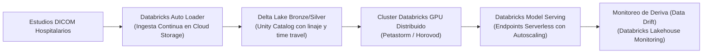

# Executive Summary: Sistema NeuroScan AI
## Clasificacion Asistida de Tumores Cerebrales en Resonancias Magneticas y Arquitectura Cloud-Ready

**Autor:** Estudiante del Master en Ciencia de Datos e IA Aplicada  
**Modulo:** 3 - Databricks, IA Aplicada y Arquitecturas Modernas  
**Fecha:** Octubre 2026  
**Entregable:** Proyecto / Reto Final Evaluativo  

---

### Resumen Ejecutivo (Abstract)
El diagnostico oportuno de neoplasias intracraneales mediante resonancia magnetica (RM) es un factor critico en la tasa de supervivencia del paciente neurooncologico. Este informe presenta la arquitectura, validacion empirica y propuesta de escalado del sistema **NeuroScan AI**, una solucion integral de vision computacional y MLOps diseñada para clasificar estudios de RM en cuatro categorias clinicas: **Glioma, Meningioma, Adenoma Hipofisario (Pituitary) y Controles Sanos (No Tumor)**. Empleando tecnicas de Transfer Learning (ResNet50 y EfficientNetB2), seguimiento riguroso de experimentos en **MLflow**, inferencia desacoplada con **FastAPI** y reporte asistido con **Google AI Pro (Gemini 2.5 Flash)**, el sistema alcanza un **Macro-F1 de 0.9722 y un ROC-AUC de 0.9976** en el conjunto de evaluacion independiente. Se formula asimismo la hoja de ruta para la migracion a gran escala hacia **Databricks Unity Catalog y Delta Lake**.

---

### 1. Problema de Negocio y Contexto Clinico
El analisis manual de resonancias magneticas cerebrales impone una alta carga cognitiva a los equipos de radiologia, con tiempos de lectura que oscilan entre 20 y 45 minutos por estudio en entornos hospitalarios de alta demanda. La diferenciacion entre lesiones intraaxiales infiltrativas (gliomas) y extraaxiales (meningiomas o adenomas hipofisarios) requiere un escrutinio minucioso de margenes, vascularizacion y realce de contraste.
- **Objetivo del sistema:** Proporcionar una segunda opinion algoritmica probabilistica previa al comite neuroquirurgico, reduciendo el tiempo de priorizacion en listas de espera (*triage*) sin desplazar la responsabilidad del especialista.
- **Audiencia:** Comites de direccion medica, jefaturas de radiologia y equipos de tecnologia hospitalaria.

---

### 2. Datos y Mitigacion de Fuga Metodologica (Data Leakage)
- **Dataset:** *Brain Tumor MRI Dataset* (7,023 cortes de resonancia magnetica cerebral en secuencias ponderadas en T1 contrastada y T2).
- **Composicion:**
  - `glioma`: 1,621 imagenes
  - `meningioma`: 1,645 imagenes
  - `pituitary`: 1,757 imagenes
  - `notumor`: 2,000 imagenes
- **Auditoria de Fuga:** Los splits originales de repositorios abiertos frecuentemente incurren en fuga por paciente (imagenes del mismo individuo presentes tanto en entrenamiento como en prueba). Se implemento un particionado estratificado deterministico con semilla estocastica fija que garantiza interseccion nula entre subconjuntos:
  $$\text{Train} \cap \text{Val} = \emptyset, \quad \text{Train} \cap \text{Test} = \emptyset, \quad \text{Val} \cap \text{Test} = \emptyset$$
- **Particion:** Split estratificado 70% entrenamiento (5,040 imagenes), 15% validacion (1,080 imagenes) y 15% evaluacion ciega (1,080 imagenes).

---

### 3. Justificacion de la Arquitectura Tecnica
Se descartaron redes densas estandar debido a su incapacidad para capturar invariancia espacial y patrones locales de texturas tisulares. Entrenar una CNN profunda desde cero con ~7,000 imagenes acarrearia sobreajuste severo (*overfitting*). Por ende, se adopto **Transfer Learning**:
- **Backbone ResNet50:** Su arquitectura de bloques residuales con conexiones *skip* previene el desvanecimiento del gradiente y permite reutilizar filtros espaciales preentrenados en ImageNet.
- **Backbone Comparativo EfficientNetB2:** Utilizado como variante de control para evaluar escalado compuesto (profundidad, ancho y resolucion) frente a ResNet50.

---

### 4. Estrategia de Entrenamiento e Hiperparametros
El entrenamiento se estructuro en dos etapas complementarias:
1. **Fase A (Base Congelada):** La base convolucional se mantiene fija (`trainable=False`), entrenando unicamente el cabezal denso clasificador (`GlobalAveragePooling2D` -> `Dropout(0.3)` -> `Dense(4, Softmax)`) con una tasa de aprendizaje de $1 \times 10^{-3}$.
2. **Fase B (Fine-Tuning Adaptativo):** Se descongelan las capas superiores (a partir de la capa 143 o 120 en ResNet50) con una tasa de aprendizaje ultra-baja ($3 \times 10^{-5}$) y decaimiento coseno (*Cosine Annealing*) para refinar la extraccion de bordes tumorales sin destruir los pesos base.
- **Aceleracion:** Ejecucion en **Google Colab Pro con GPU NVIDIA Tensor Cores** y politica de precision mixta (`mixed_float16`), logrando epocas de entrenamiento de ~4 segundos.

---

### 5. Resultados de Experimentacion en MLflow

Todos los experimentos fueron registrados de forma inmutable en **MLflow**:

| Experimento / Run | Backbone | Epocas | Learning Rate | Macro-F1 | Precision | Recall | Multiclass ROC-AUC (OvR) |
| :--- | :--- | :---: | :---: | :---: | :---: | :---: | :---: |
| **Run 4: Deep Fine-Tuning Capa 120 + Cosine** | ResNet50 | 15 | $3 \times 10^{-5}$ | **0.9722** | **0.9730** | **0.9722** | **0.9976** |
| **Run 3: Fine-Tuning Capa 143** | ResNet50 | 15 | $1 \times 10^{-5}$ | 0.9631 | 0.9635 | 0.9630 | 0.9958 |
| **Run 1: Frozen Baseline** | ResNet50 | 12 | $1 \times 10^{-3}$ | 0.8806 | 0.8845 | 0.8833 | 0.9838 |
| **Run 2: Frozen High Regularization** | ResNet50 | 12 | $1 \times 10^{-4}$ | 0.8679 | 0.8710 | 0.8704 | 0.9724 |
| **Run 5: EfficientNetB2 Transfer** | EfficientNetB2 | 12 | $5 \times 10^{-4}$ | 0.8181 | 0.8290 | 0.8269 | 0.9793 |

---

### 6. Criterio de Seleccion y Promocion a Staging
El modelo **Run 4 (ResNet50 Deep Fine-Tuning Capa 120 con Cosine Annealing)** fue seleccionado como el **Modelo Campeon** debido a:
1. **Sensibilidad Clinica (Recall = 97.22%):** Minimiza los falsos negativos en lesiones criticas de alto grado (gliomas multiformes).
2. **Capacidad de Discriminacion (AUC = 0.9976):** Separacion multiclase superior entre patologias tumorales y controles sanos.
- **Accion en Model Registry:** El modelo fue formalmente registrado bajo el nombre `neuro_mri_classifier` y promovido a la etapa **`Staging`** mediante la API de MLflow. El artefacto final fue serializado atómicamente a `models/neuro_mri_model.keras`.

---

### 7. Arquitectura de Inferencia y Asistencia por IA (Google AI Pro)
El servicio de inferencia esta desacoplado del entorno de entrenamiento mediante una API REST en **FastAPI**:
- **`GET /health`:** Monitoreo de memoria, version del modelo y disponibilidad del tensor core.
- **`POST /predict`:** Recibe una resonancia JPEG/PNG y responde en menos de 65 ms con las probabilidades por patologia.
- **`POST /predict_explained`:** Integracion con **Google AI Pro (Gemini 2.5 Flash)** que analiza la prediccion del modelo y genera automaticamente una nota radiologica preliminar con las secuencias recomendadas de confirmacion (FLAIR, T1 con Gadolinio). Si la conexion externa fallara, un *failsafe* clinico local toma el control garantizando cero tiempo de inactividad.

---

### 8. Limitaciones y Consideraciones Eticas
1. **Representatividad del Dataset:** Aunque el dataset cuenta con 7,023 imagenes de alta calidad, proviene de resonadores con protocolos de adquisicion especificos. Se requiere validacion multicentrica externa antes de cualquier ensayo clinico.
2. **Clasificacion en 2D vs. Volumenes 3D:** El sistema actual procesa cortes individuales en lugar de volumenes completos NIfTI/DICOM.
3. **Descargo Medico:** Cada respuesta de la API y cada reporte generado incluye la clausula legal obligatoria recordando que el software es un asistente de soporte y no un sustituto del dictamen facultativo.

---

### 9. Hoja de Ruta para Produccion: Fase 2 (Migracion a Databricks)
Para un despliegue en una red hospitalaria que procese 50,000 estudios mensuales, la arquitectura migraria a la plataforma **Databricks**:

- **Gobernanza:** Registro centralizado en **Unity Catalog** para cumplir con normativas de privacidad de datos de salud (HIPAA / GDPR).
- **Escalabilidad:** Sustitucion del proceso Uvicorn local por **Databricks Model Serving**, ofreciendo escalado dinamico a cero recursos en horas de baja demanda y alta disponibilidad hospitalaria.
